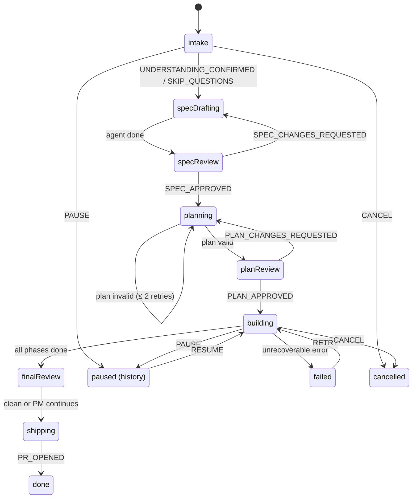
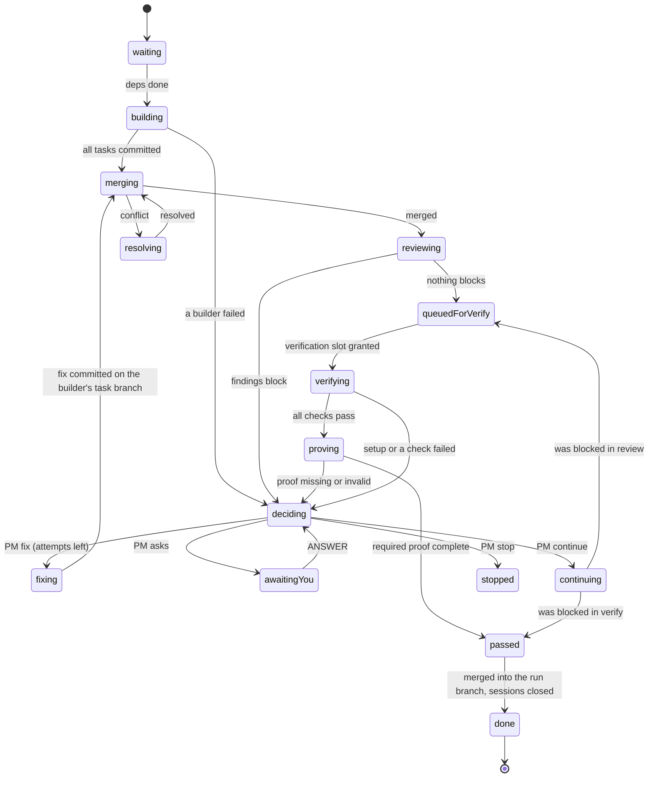
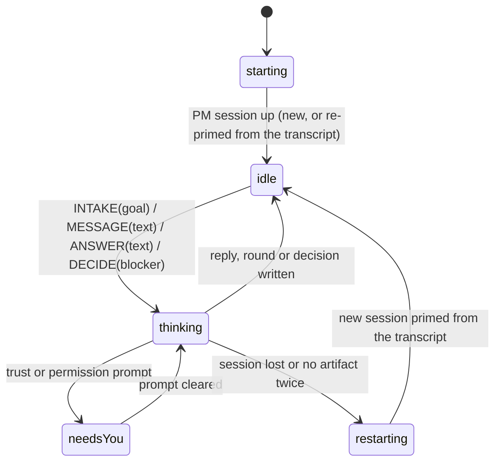
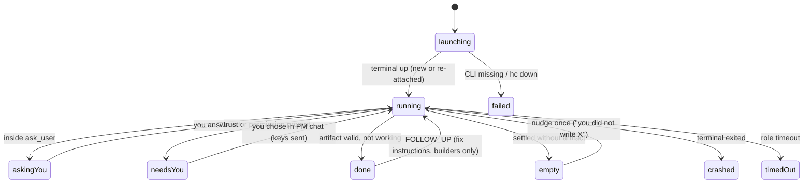

# bdc v2: process spec

Status: agreed, 16 Nov 2026, after three rounds of Yoni's comments (each settled decision is marked ✅). This is what v2 is built against.

---

## 0. Why start over

v1 shipped panels and an engine that each looked done in isolation but did not work together. What today's QA found, in short:

| Area | What was wrong in v1 | What v2 does instead |
|---|---|---|
| State | Run state was a JSON file that the engine, the CLI and the panels all wrote. `retry` and `answer` edited JSON and nothing acted on it. | One owner. A single XState actor per run holds all state; everything else sends it events. |
| Transitions | Implicit, spread across `cycle.ts` (one 300-line function). A failing verify still shipped "pass". | Every transition is in a statechart, typed, tested, drawable. A transition that is not in the chart cannot happen. |
| Agent results | Read by scraping the agent's TUI screen; broke for every real agent. | Every agent writes one artifact file with a fixed schema. The screen is only for people. |
| Agent completion | Guessed from status events; a startup `idle` killed pi workers. | One agent actor with explicit rules, tested against recorded hc event logs. |
| The PM | Did not exist. Questions were static text with buttons that did nothing. | A real PM agent owns every decision that is not mechanical, and talks to you. |
| Reviewers | Lens prompts were never sent; one generic reviewer labelled everything `security`. | One reviewer agent per lens, prompts shared across projects (agreed 16 Nov). |
| Merges | Fast-forward only, so any phase with two tasks failed. | Merge commits; a conflict goes to a builder. |
| UX | Buttons that did nothing (Save, Test env, toggles), panels that ran `bdc init` on click, raw paths and enums, many panels with overlapping jobs. | Fewer screens, each with one job; every visible control does a real thing; the UI follows the run. |
| Tests | Unit tests passed while real runs failed; the suite opened tabs in your Herdr app. | The machine is tested on its own (every path); integration uses a fake hc; the real-agent e2e is a written checklist and is the definition of done. |

What v1 got right and v2 keeps: Herdr + hc as the runtime, agents as interactive CLIs in hc terminals, the `.herd/` folder, git worktrees per unit of work, the design frames (01–12) as the visual language, shared review lenses.

---

## 1. Goal and definition of done

**Goal.** You type what you want built. bdc turns it into a reviewed spec, a phase plan, parallel builders, reviews and verification, and ends with a pull request you can trust, asking you only when a person must decide.

**Done for v2.0** means all of this passes on your Mac, with real agents, from the Herdr UI:

1. New project from a repo → goal typed → the PM grills you on it (grill-me rounds, §4.1) and you answer every question in the question tool, one at a time.
2. Spec written, you select text in the rendered spec and comment on it, it is revised, you approve.
3. Plan written (≥ 2 phases, one with ≥ 2 tasks), you approve.
4. Builders (the CLI and model you chose for the builder role) build in parallel worktrees; tasks merge.
5. Each lens reviews each phase with the prompt you wrote for it; one finding goes to the PM; the PM either has it fixed or asks you.
6. A failing verify goes to the PM; you answer; the PM acts on your answer or asks a follow-up.
7. Every phase shows its proof (test report from bdc, screenshots or an e2e run from the verifier where the phase changes UI); the lenses review the whole run; the PR is opened with the proof in it (local file target, then a real GitHub target).
8. You quit Herdr mid-build, reopen it, and the run continues where it was.
9. No terminal, tab or file is left behind that you did not ask for.

---

## 2. Vocabulary

| Term | Meaning |
|---|---|
| **Project** | A git worktree bdc works in, with `bdc.yaml`. One project, many runs over time. |
| **Run** | One goal from intake to PR. Has one run actor (§5) and one folder `.herd/runs/<run>/`. |
| **Spec** | Markdown describing what will be built. Versioned (`spec.v1.md`, `spec.v2.md` …). |
| **Plan** | `phases.yaml`: phases with `deps` (a DAG), each with tasks, an env and verify checks. |
| **Phase** | A unit that is built, reviewed and verified on its own branch, then merged into the run branch. |
| **Task** | One builder's job inside a phase. Tasks of a phase run in parallel. |
| **Lens** | A review angle (security, perf, ux, …) with a prompt and a `block_on` severity. |
| **Agent** | A CLI (claude, pi, …) in an hc terminal with a role and a model. |
| **Artifact** | The one file an agent must write to report its result. |
| **Question** | Something the PM asks you. Lives in PM chat until answered. |
| **Decision** | What the PM chose to do about a blocked phase: fix, continue, ask, stop. |

---

## 3. Roles and agents

### 3.1 Roles

| Role | Does | Artifact it writes |
|---|---|---|
| **PM** | Talks to you. Grills you on the goal, answers your messages, decides on every blocked phase. Never edits code. | `pm/<n>.decision.json`, `pm/<n>.reply.json`, `intake.json` |
| **Spec writer** | Writes and revises the spec from the brief and your comments. | `spec.v<n>.md` + `spec.v<n>.meta.json` |
| **Planner** | Writes the phase plan from the approved spec. | `phases.yaml` |
| **Builder** | Implements one task in its own worktree and commits there. Also fixes what the PM sends back about its task (§4.4). | a commit on its branch + `report.json` |
| **Reviewer** (one per lens) | Reviews a phase's merged diff through one lens, with the lens prompt you wrote. Never edits. | `findings.<lens>.json` |
| **Verifier** | Produces the proof a phase needs that a command can't: screenshots, e2e and UI walkthroughs, recordings (§4.4.1). A different session from the builders, so nobody proves their own work. Never edits code. | `submit_proof` → `proof/<item>.*` |

✅ **Every role's CLI (harness) and model is yours to choose**, per project, in first run and in Settings (`bdc.yaml` underneath). bdc ships no built-in agent choice: first run asks for each role, offering the CLIs it finds on PATH and their models, with "same as PM" / "same as builder" shortcuts. A role can name any CLI bdc has an adapter for (v2.0: claude, pi; later: codex, cursor, gemini).

✅ **Fixes go to the same builder.** The PM's fix instructions are sent into the builder session that wrote the code (same CLI, same model, same conversation), so its context and prompt cache are reused. Builder sessions therefore stay alive until their phase is done (§5.5).

(DeepSeek V4.1 Flash is what *I* use to build v2 itself, §13. It is not a bdc default.)

### 3.2 How an agent runs

- Every agent is an interactive CLI in an hc terminal, started through `bdc-adapt` (reports OSC 7501 working/done/blocked).
- Terminals are labelled `bdc.run`, `bdc.phase`, `bdc.role`, `bdc.key` (a stable key per job, e.g. `p2/t1/attempt-1`).
- Agents report through **bdc's tools** (§3.4), not by writing files by hand: the spec writer calls `submit_spec`, the reviewer `submit_findings`, and so on. A tool validates its input against the schema and answers with the exact problems, so the agent fixes them in the same turn. The agent's job is done when its submit tool has accepted a result and the agent has stopped working.
- bdc never parses the screen for results.
- ✅ **You never need to see an agent terminal.** Agents run in hc terminals that are not placed in Herdr tabs or spaces (no tab clutter, no placement bugs). Everything you need from them reaches you as UI: status in words, their artifacts, and PM chat. hc keeps the screen only for bdc's own failure diagnosis ("what did it print before it crashed").
- **Launch is idempotent.** Before launching, the agent actor looks for a live terminal with the same `bdc.key`; if one exists it re-attaches instead of starting a second agent. This is what makes restore-after-crash safe (§5.7).

### 3.3 When an agent is finished: the rules

The agent actor (§5.5) decides from three inputs: hc status events for that terminal, the artifact, and the terminal's exit.

| Seen | Result |
|---|---|
| Submit tool accepted a result and agent not `working` | `done` |
| Agent is inside `ask_user` (waiting on you) | `askingYou`: not idle, not timed out; the timeout clock is stopped |
| Agent reported its own `working` at least once, then `idle`/`done`, nothing submitted, for 20 s | `empty` (finished without result) |
| `working` with `app=bdc` only (the adapter's launch marker) followed by `idle` | ignored (startup idle, the v1 pi bug) |
| Trust prompt or permission prompt on screen, or `blocked` status | `needsYou`: the prompt's text goes to PM chat as a card with its choices (e.g. *Trust this folder* / *Don't*); your click is sent to the terminal as keys. Keep waiting. |
| Terminal exited or was killed, artifact missing | `crashed` |
| No `done` within the role's timeout (default 30 min builders, 15 min others) | `timedOut` |

Every rule has a test built from a recorded real hc event log (claude and pi), not hand-written events.

### 3.4 bdc's tools for agents (MCP), including the question tool

Every agent is started with bdc's MCP server attached (`bdc mcp`, stdio, scoped to that agent's run, role and key). Its tools depend on the role:

| Tool | Roles | Does |
|---|---|---|
| `ask_user({ questions })` | PM only | ✅ **The question tool.** Hands you one or more structured questions (below) and returns at once; the PM ends its turn, and **your answers arrive as its next message** when you have answered in the UI. (Not a blocking call, so a PM waiting hours on you never hits a tool timeout, and a daemon restart while you think loses nothing.) |
| `submit_brief`, `reply`, `decide`, `propose` | PM | the intake brief, a chat reply, a decision on a blocked phase (§6), a proposed action (Apply / Discard) |
| `submit_spec` | spec writer | the spec markdown, plus per-comment notes on what changed |
| `submit_plan` | planner | the phase plan; validated (schema, cycles, disjoint task paths, proof per phase) |
| `report_task` | builder | the task is committed; what changed; anything it could not do |
| `submit_findings` | reviewer | findings for one lens |
| `submit_proof` | verifier | one proof item (file + what it shows) |
| `get_context` | all | the goal, the spec, the phase, the transcript, so prompts stay short |

A question passed to `ask_user`:

```json
{
  "id": "auth-provider",
  "title": "Which sign-in provider?",
  "body": "Short context, one or two sentences.",
  "kind": "single" | "multi" | "text" | "confirm",
  "options": [{ "id": "google", "label": "Google Workspace", "hint": "you already use it" }, { "id": "okta", "label": "Okta" }],
  "recommended": "google",
  "allowOther": true
}
```

How it looks (PM chat, §9.4): **one question at a time** on a card: title, a line of context, the options as buttons with the recommended one marked, *Other…* for a typed answer, *Back*, *Skip*, and "2 of 4". Keyboard: 1–9 picks, Enter confirms the recommended. After the last question, a one-line summary of your answers and *Send*. Nothing is ever a block of numbered text to read through.

CLIs without MCP support get the same contract through files (`ask.json` in, `answer.json` out); v2.0 targets claude and pi, which both take MCP.

✅ **Only the PM asks you questions.** Builders, reviewers and the verifier raise a blocker; the PM decides whether to ask you, so you have one person to talk to.

---

## 4. The process, stage by stage

Each stage lists: who acts, what you see, what you can do, what it produces, how it ends.

### 4.1 Intake: the PM grills you (✅ grill-me)
- **You:** type a goal (or pick an example) in PM chat and press Start.
- **PM:** runs the **grill-me** method (the `grilling` skill): it maps the goal as a design tree and asks in **rounds**; each round is the questions it can ask now without guessing at answers it has not heard, each with its recommended answer. It looks facts up in the repo itself and never asks you for something it can find. Rounds continue **as many as needed** until nothing is left silently assumed.
- ✅ **Every round goes through the question tool** (`ask_user`, §3.4): you get the round's questions one at a time as buttons, not as text. A round of five is five quick clicks when you agree with the recommendations.
- **You see:** the question card in PM chat. The main area shows "Getting the goal straight" and the decisions settled so far, which grow as you answer.
- **You can:** pick, type *Other…*, skip a question, or **Skip the rest** (the PM writes the brief from what it has and lists what it assumed).
- **Ends:** the PM asks one last `confirm` question with the shared understanding → you confirm (or correct) → `submit_brief` `{ brief, decisions[], assumptions[] }` → Spec drafting.
- The skill is given to the PM through its CLI's own skill mechanism when it has one (claude: the installed `grill-me` / `grilling` skills); otherwise its text is put in the PM's prompt. bdc ships a copy of the skill text so it works on any machine.

### 4.2 Spec drafting → Spec review
- **Spec writer** writes `spec.v1.md`.
- **You see:** ✅ the spec **rendered as markdown** (headings, lists, tables, code), not as source lines.
- **Commenting:** ✅ select any text in the rendered spec → a **Comment** button appears by the selection → type the comment. The comment is anchored to the quoted text (quote + a little text before and after, so it survives small edits), highlighted in the spec, and listed in a side column. Comments can be replied to and resolved.
- Buttons: **Approve spec**, **Request changes** (needs at least one open comment or a note).
- Request changes → the spec writer gets the comments with their quotes, writes `spec.v<n+1>.md` and says per comment what it changed; you see the new version with the changes marked; comments it addressed show as resolved; back to review.
- **Ends:** Approve → Planning.

✅ If gpui-kit's markdown view cannot report a selection across paragraphs, selecting within one paragraph is enough.

### 4.3 Planning → Plan review
- **Planner** writes `phases.yaml`: phases, deps, tasks (each with the paths it expects to touch) and per-phase verify checks on top of the repo's verification setup (§7.4). bdc validates it (schema, no cycles, unique ids, every phase has ≥ 1 check, tasks in a phase declare disjoint paths).
  Invalid → the planner is sent the problems and tries again (max 2), then the PM is asked.
- **You see:** the phase DAG (frame 02) and a per-phase inspector with its tasks and checks. **Approve plan**, **Request changes** (comment on a phase).
- **Ends:** Approve → Build.

### 4.4 Build
Phases run as a DAG, each phase as its own actor (§5.3), at most `concurrency` phases at once.

Per phase:
1. **Wait** for deps to be done.
2. **Build:** one builder per task, in parallel, each in its own worktree from the phase branch.
3. **Merge** task branches into the phase branch (fast-forward or merge commit). Conflict → the builders whose tasks conflict get the conflict; one resolves it on the phase branch.
4. **Review:** one reviewer per lens, in parallel. Findings at or above the lens's `block_on` (and not overridden) block.
5. **Verify:** the repo's verification setup (§7.4) runs against the phase worktree: setup, the repo checks plus the phase's own checks, teardown. Waits for a verification slot if the repo allows fewer parallel verifications than phases.
6. Blocked at 4 or 5 → **PM decides** (§6): *fix* (the PM's instructions go into the session of the builder whose task the problem is in; it commits on its task branch, which merges again, back to 4), *continue* (record override, go on), *ask* (question to you; this phase waits, others go on), *stop phase*.
7. **Prove:** the phase's required proof is collected (§4.4.1). Missing or invalid proof blocks like a failed check → PM.
8. **Passed** → merge phase branch into the run branch → close the phase's builder and verifier sessions → done.

Which builder gets a fix: the one whose task touched the files in the finding or failing check (from its commits); if none or several, the PM names one in its decision.

You see: Build (frame 03), Phase detail (frame 04), Reviews (§8), PM chat.

#### 4.4.1 Proof

✅ Every phase must come with proof that it works, and nobody proves their own work.

- **What proof a phase needs** is set by the planner in `phases.yaml`, per phase, from what the phase changes, and you approve it with the plan. You can add or remove items in plan review.
  ```yaml
  proof:
    - kind: tests        # test report of the repo checks + this phase's checks
    - kind: log          # e.g. migration output
      shows: "the migration runs on a copy of prod schema"
    - kind: screenshot   # UI changes
      shows: "the new sign-in screen, empty and error states"
    - kind: e2e          # a recorded end-to-end run
      shows: "sign in with Google and land on the dashboard"
  ```
- **Who provides it:**

  | Proof | Provided by | How |
  |---|---|---|
  | `tests`, `log`, exit codes, durations | **bdc itself** | captured while running the verification setup and the checks (§7.4). Nothing an agent can write or edit. |
  | `screenshot`, `e2e`, `recording`, `walkthrough` | **the verifier agent** | runs against the phase's verified environment (browser automation, the app's own e2e tooling, or driving the CLI) and calls `submit_proof` per item. A different session from the builders. |
  | `manual` | **you** | the PM asks you (question tool) to confirm something only a person can judge; your answer is the proof. |

- **Checked before the phase passes:** every required item exists; files are what they claim (a screenshot is an image of the right size, an e2e report says passed, a log is not empty); each item's `shows` is matched to it by the verifier. Lenses review the proof along with the diff (a UX lens looks at the screenshots).
- **Shown** on the Phase screen (thumbnails, logs, reports), on the Reviews screen next to findings, and in the PR under *Proof* for each phase.

✅ **On GitHub, proof goes in a PR comment:** bdc posts one comment per phase with its screenshots and recordings uploaded as attachments, and the PR body links to each. For the local file target, proof stays in `.herd/runs/<run>/phases/<phase>/proof/` and is linked from `pull-request.md`.

### 4.5 Final review
- ✅ **Lenses only.** When every phase is done, each lens reviews the whole run diff once against the spec (lenses with `runs: final-only` run only here). There is no separate final-reviewer role.
- Blocking findings → PM (same decision loop, at run level).
- **Ends:** clean → Ship.

### 4.6 Ship
- bdc writes the PR body from evidence (spec, phases, verify logs, findings, overrides with who and why).
- **You see:** Ship (frame 07): the PR preview, targets, **Open pull request** (draft or ready).
- **Ends:** PR opened (or file written) → Done.

### 4.7 Always available
- **Message the PM** at any time (not only answers). The PM replies; it may propose an action (e.g. "keep p5's env up"), shown as a card with **Apply** / **Discard** (frame 05). Applying sends the matching event.
- **Pause / Resume** the run (agents already running finish their current turn; nothing new starts).
- **Cancel** the run (confirm; stops agents, keeps branches, marks cancelled).
- **Retry** a failed phase or a failed step.

---

## 5. State machines (XState v5)

XState 5.33 (stable). All machines are defined with `setup({ types, actors, actions, guards }).createMachine(...)`, so every event, context and actor is typed.

### 5.1 Actor tree

```text
runActor (runMachine)                      one per run, owned by the bdc daemon
├── pmActor (pmMachine)                    long-lived: PM conversation and decisions
├── agentActor (agentMachine) × n          spec writer, planner, run-level lens reviews, ...
└── phaseActor (phaseMachine) × phases     spawned at Build
    └── agentActor × (tasks + lenses + fixes)
```

### 5.2 runMachine



Notes:
- `paused` uses a history state, so RESUME returns to wherever it was (any stage, not only building).
- `CANCEL` and `PAUSE` are accepted in every non-final state (drawn for two to keep the chart readable).
- `failed` keeps the error and the step that failed; `RETRY` re-enters that step, not the stage.

**Context** (serializable only): `runId, root, goal, brief, specVersion, planHash, phaseIds, verifySlots { max, held: phaseId[] }, overrides[], error?, prTargets, startedAt`.

### 5.3 phaseMachine



- `deciding` always records *why* (`blocker: { kind: build|conflict|review|verify-setup|verify|proof, summary, evidence[] }`) and asks the PM (§6).
- `fixing` sends the PM's instructions into the chosen builder's live session (✅ same builder, same model, prompt cache reused). Bounded by `max_attempts`; when spent, the PM can only *ask*, *continue* or *stop*.
- `verifying` always runs the repo's teardown on the way out, pass or fail, and releases the verification slot.
- `stopped` is final for the phase; dependants stay `waiting` and the run's final gate says so.
- Guards are named and unit-tested: `depsDone`, `slotFree`, `attemptsLeft`, `blockingFindings`, `checksPassed`.

### 5.4 pmMachine



- ✅ **One long-lived PM session per run.** Every PM turn is a message sent into that session (`hc send`), and the reply is an artifact file named in the message.
- `pm/transcript.md` records everything said both ways, every question, answer and decision. If the session is lost (crash, timeout, Mac restart), a new one starts and is primed with the transcript; you see one continuous conversation either way.
- One PM turn at a time; requests from different phases queue, so the PM always decides with the latest picture.

### 5.5 agentMachine



- Input: `{ role, key, cwd, cli, model, prompt, artifact: { path, schema }, timeoutMs, keepAlive }`.
- Output on each `done`: the parsed, validated artifact.
- `empty` gets exactly one nudge (`hc send` "write <artifact> now"); a second `empty` reports failure to the parent.
- Observation is a `fromCallback` actor following `hc events --label bdc.key=<key>` plus a 2 s artifact check; no polling loops in the machine itself.
- ✅ **Terminals close as soon as they are not needed:** spec writer, planner and reviewers close on `done`; builders and the verifier have `keepAlive` and close when their phase is done (fixes go to the builders); the PM closes when the run ends. A cancelled or failed run closes all of its terminals. Nothing is left behind.

### 5.6 Events

| Event | From | Payload | Accepted in |
|---|---|---|---|
| `GOAL_SUBMITTED` | you | `goal` | (creates the run) |
| `ROUND_ANSWERED` | you | `answers: [{ question, text \| "accept" }]` | intake |
| `UNDERSTANDING_CONFIRMED` | you | `corrections?` | intake |
| `SKIP_QUESTIONS` | you | | intake |
| `SPEC_COMMENT` | you | `quote, prefix, suffix, body, replyTo?` | specReview |
| `SPEC_COMMENT_RESOLVED` | you | `commentId` | specReview |
| `SPEC_CHANGES_REQUESTED` | you | `note?` | specReview |
| `SPEC_APPROVED` | you | | specReview |
| `PLAN_COMMENT` | you | `phaseId, body` | planReview |
| `PLAN_CHANGES_REQUESTED` | you | `note?` | planReview |
| `PLAN_EDITED` | you | `phasesYaml` (validated first) | planReview |
| `PLAN_APPROVED` | you | | planReview |
| `MESSAGE` | you | `text` | any non-final |
| `ANSWER` | you | `questionId, text` | phase in awaitingYou |
| `PROMPT_CHOICE` | you | `agentKey, choice` | an agent in needsYou |
| `APPLY_PROPOSAL` / `DISCARD_PROPOSAL` | you | `proposalId` | any |
| `OVERRIDE` | you | `phaseId, lens?, reason` | phase in deciding / awaitingYou |
| `RETRY` | you | `phaseId?, step?` | failed, phase stopped |
| `PAUSE` / `RESUME` / `CANCEL` | you | | any non-final |
| `OPEN_PR` | you | `draft` | shipping |
| `SETTINGS_CHANGED` | you | partial settings | any (applies to new agents only) |
| `VERIFICATION_TESTED` | daemon | step results | (project level, before a run) |
| `xstate.done.actor.*` / `xstate.error.actor.*` | agents | artifact / error | internal |

Your events reach the run actor through the daemon socket (§7.2); the CLI and every panel send the same events. Nothing else changes run state.

### 5.7 Persistence and restore

- After every transition the daemon writes `actor.getPersistedSnapshot()` to `.herd/runs/<run>/machine.json` (atomic rename) and appends the event to `events.jsonl`.
- Restore: `createActor(runMachine, { snapshot })`. XState restores invoked and spawned actors recursively, does **not** re-run actions, and **restarts invocations**. So every invoked actor must be safe to start again:
  - agent actors re-attach by `bdc.key` instead of relaunching;
  - git and env steps check what is already done (branch has the commit, env health check) before acting.
- `machine.json` carries a `machineVersion`. A snapshot from an older version is migrated by a written migration, or the run is offered as "restart from the last completed stage".
- `events.jsonl` is the audit log and the source for the UI's activity feed; it is also enough to replay a run in tests.

---

## 6. The PM's decision loop

Input to every decision (written to the transcript, sent to the PM):
- the goal and the approved spec summary,
- the blocked phase, the blocker kind, the evidence (findings, failing check output, conflict files),
- attempts used / allowed,
- everything said about this phase so far (questions, your answers, earlier decisions).

The PM calls `decide` with one decision. When the decision is *ask*, the PM calls `ask_user` itself (question tool) and decides again with your answer, all in its one session:

```json
{
  "action": "fix" | "continue" | "ask" | "stop",
  "reason": "one sentence, shown in PM chat and in the PR when it continues",
  "instructions": "for fix: what the builder should change",
  "question": "for ask: one short question",
  "options": ["for ask: 2 or 3 choices"],
  "recommended": 0,
  "builder": "for fix: the task whose builder gets it, when not obvious"
}
```

Rules the PM is given:
- Decide yourself when the fix is mechanical and inside the spec.
- Ask when it is a product decision, a risk you would accept on the person's behalf, or a change to the spec.
- After an answer: act on it if it settles the question; ask one follow-up if it does not. Never ask the same question twice.
- `continue` on a verify failure or a high finding must quote the answer or reason that justifies it; it appears in the PR under *Overrides*.

You can also answer by typing freely; the PM interprets it. You can override directly (OVERRIDE event) without the PM, and that is recorded as yours.

---

## 7. Runtime

### 7.1 Processes

- **bdc daemon:** one per project, started on demand, runs in a hidden hc terminal labelled `bdc.role=daemon` (so it survives closing the Herdr window, like the agents). Owns every run actor in the project. Exits when no run is active for 10 minutes.
- **bdc CLI:** sends events to the daemon and reads snapshots; starts the daemon if needed.
- **Herdr panels:** read the projection and send events through the CLI. They never write files.

### 7.2 Interfaces

- Socket: `.herd/daemon.sock` (JSON lines: `{ type: "send", runId, event }`, `{ type: "subscribe", runId }`).
- Projection: the daemon writes `.herd/runs/<run>/view.json` after each transition: a flat, UI-ready view (stage, phases with human status words, questions and rounds, PM transcript, what each agent is doing in words, verification results, all review findings, evidence). Panels render only this.
- `bdc send <dir> <EVENT> [json]`, `bdc status <dir>`, `bdc watch <dir>`.

### 7.3 Git

- Root checkout never moves.
- Branches: `bdc/<run>` (run), `bdc/<run>.<phase>` (phase), `bdc/<run>.<phase>.<task>` (task): siblings, because git cannot hold both `bdc/<run>` and `bdc/<run>/<phase>`. Fixes are new commits on the task branch by the same builder, which then merges into the phase branch again. Worktrees under `.worktrees/` (git-ignored).
- Merge = fast-forward when possible, else a merge commit. Conflict → abort, then one of the conflicting builders resolves it in the phase worktree (artifact: merge committed).
- The PR is opened from `bdc/<run>` to the base branch.

### 7.4 Verification setup (✅ generic, per repo)

v1's "side envs" were a bdc idea forced on every repo. v2 has one generic **verification setup per repo**: how to get this repo into a testable state, how to check it, how to clean up. Phases only add checks.

```yaml
# bdc.yaml
verification:
  env:                      # given to every step, after bdc's own variables
    DATABASE_URL: postgres://localhost:${BDC_PORT_BASE}/app
  setup:                    # in order, in the worktree being verified
    - run: npm ci
    - run: docker compose -p bdc-${BDC_SLOT} up -d db
  ready:                    # optional; retried until it passes or times out
    run: pg_isready -h localhost -p ${BDC_PORT_BASE}
    timeout: 120
  checks:                   # every phase runs these
    - name: types
      run: npm run typecheck
    - name: unit
      run: npm test
  teardown:                 # always runs, pass or fail
    - run: docker compose -p bdc-${BDC_SLOT} down -v
  parallel: 1               # verifications at once in this repo (default 1)
  timeout: 1800             # whole verification, seconds
```

- Phases add their own checks in `phases.yaml` (`checks:` with `run:` or `agent:` steps; an `agent:` check is an agent with an artifact, e.g. "click through the new screen and report").
- bdc gives every step `BDC_WORKTREE`, `BDC_PHASE`, `BDC_RUN`, `BDC_SLOT` (0 … `parallel`-1) and `BDC_PORT_BASE` (a free port range per slot), so parallel verifications in one repo can avoid each other. A repo that cannot run two at once keeps `parallel: 1`, and phases queue for verification.
- **First run sets it up with you:** bdc (or the PM) proposes a setup from what the repo has (`package.json` scripts, `Makefile`, `docker-compose.yml`, CI workflow files), you edit it on the Verify screen, and **Test setup** runs setup → ready → checks → teardown on a scratch worktree of the base branch and shows each step's real output. A run cannot start until the setup has passed once (or you choose *No verification for this repo*, which the PR then says).
- Each verification writes `phases/<phase>/verify.json` (every step: command, exit code, duration, output tail) shown on the Phase and Verify screens.

---

## 8. Review lenses (agreed 16 Nov) and all reviews

- Lens list and `block_on` per project in `bdc.yaml`.
- ✅ **You write the prompt for each lens.** Prompts in `~/.config/bdc/reviewers/<lens>.md`, shared by every project; a project may keep its own copy in `.herd/reviewers/<lens>.md`. The Reviewers screen shows which, with **Edit**, **Save as shared**, **Keep a project copy**, **Add lens**.
- Per lens: `runs: every-phase | matching-scope | final-only`, `scope` globs, `block_on: low|medium|high|critical|none`, CLI and model.
- One reviewer agent per lens per phase, in parallel; artifact `findings.<lens>.json`:
  `{ "findings": [{ "id", "severity": "low|medium|high|critical", "summary", "file?", "line?", "fix?" }] }`.

### 8.1 Reviews screen (✅ see all reviews)

One place with every finding of the run (and earlier runs of the project):

- A list of all findings: severity, lens, phase, summary, file:line, and their **status**: open · being fixed · fixed (in which commit) · continued by the PM (with reason) · overridden by you · advisory.
- Filters: lens, phase, severity, status; *Only what blocks*.
- Opening a finding shows its full text, the code it points at, the PM's decision and the fix commit's diff.
- Per lens and phase: whether the review ran, passed or blocked, and when.
- The Reviewers screen (lens setup, prompts) is separate and opens from here.

---

## 9. UX

### 9.1 Principles
1. **The UI follows the run.** The main area shows the stage that needs attention; you never hunt for where you are.
2. **One primary action per screen**, always the thing the run is waiting for.
3. **No dead controls.** A control is shown only if it does something now; disabled controls say why.
4. **People words.** "waiting on you", "fixing", "2 of 3 checks pass", never `in_progress`, `awaitingYou` or a file path unless you asked for detail.
5. **Talk, don't configure.** Anything you would do in a settings form can also be said to the PM.
6. **Truthful status.** If an agent is waiting on a trust or permission prompt, PM chat shows that prompt with its choices; you answer there, never in a terminal.
8. **No terminals.** You never need to open an agent's terminal. What an agent is doing is said in words ("pi is writing src/hello.sh", "security review: 2 findings so far").
7. **Nothing happens on click except what the label says** (v1 ran `bdc init` when you selected a space).

### 9.2 Layout (dev-cycle)
```text
┌ sidebar ─┬ main (follows the stage) ───────────────┬ PM chat ───────┐
│ projects │ header: project · run · stage stepper     │ transcript      │
│ runs     │                                            │ question cards  │
│          │ stage view (one of the screens below)     │ composer        │
└──────────┴────────────────────────────────────────────┴────────────────┘
```
- ✅ **Single stage-following main area.** It shows the current stage's screen and moves on by itself when the run does (unless you are mid-comment or mid-edit; then a banner offers *Go to <stage>*).
- Stage stepper: Goal · Spec · Plan · Build · Review · Ship. Done stages are clickable (read-only); the current one is highlighted; a badge shows "needs you".
- Secondary screens (Reviews, Reviewers, Verify setup, Settings) open from the header into the main area, with *Back to <stage>*.
- The sidebar lists projects and their runs (status in words). No agents list: agents are not something you manage.

### 9.3 Screens

| Screen | Frame | Job | Primary action | Empty / loading / error |
|---|---|---|---|---|
| First run | 11c / 12 | type the goal | Start | missing CLI warning once |
| New project | 11b | pick repo, make worktree | Create | (as designed in 11b notes) |
| Goal | 12 | the PM's grilling rounds and settled decisions | Confirm understanding | "PM is reading the repo…" |
| Spec | 01 | read rendered spec, select text to comment, approve | Approve spec | "Writing the spec…" with what the writer is doing |
| Plan | 02 | see the DAG, approve | Approve plan | invalid plan shows the problems and that the planner is fixing them |
| Build (Progress) | 03 | see what runs, what waits on you | (none; questions are in PM chat) | per phase: words + step track |
| Phase detail | 04 | one phase: tasks and what each builder did, review, verify steps, PM decisions | context-dependent (Answer, Retry) | |
| Reviews | new | every finding and its status (§8.1) | (none) | "No findings yet" |
| Verify setup | 05 | the repo's verification setup and per-phase checks | Test setup / Save | each step's real output |
| Reviewers | 06 | lenses, their prompts, block levels | Save | |
| Ship | 07 | PR preview, open it | Open pull request | |
| Settings | 08 | roles, models, limits | Save | |

### 9.4 PM chat
- Transcript of the run: your messages, the PM's replies, decisions ("Sending the p2 builder back to fix SEC-1"), proposals (Apply / Discard), and a one-line record of every question you answered.
- ✅ **The question tool:** when the PM asks (grilling rounds, blocked phases, confirmations) or an agent hits a trust / permission prompt, a question card sits above the composer: one question at a time, options as buttons with the recommended one marked, *Other…* to type, *Back*, *Skip*, "2 of 4", keys 1–9 and Enter. Answered questions collapse into the transcript as "Q → your answer".
- Composer always active. `@phase` and `#task` mentions scope a message. Enter sends.
- Header: PM model and what it is doing ("thinking", "waiting on you", "idle").

---

## 10. Files

```text
bdc.yaml                          project config (roles, models, lenses, limits, PR targets)
.herd/
  daemon.sock                     daemon socket
  reviewers/<lens>.md             project lens prompt (optional)
  runs/<run>/
    machine.json                  persisted XState snapshot (single writer: daemon)
    events.jsonl                  every event, append-only
    view.json                     UI projection (single writer: daemon)
    goal.md, intake.json            brief, settled decisions, assumptions
    spec.v<n>.md, spec.v<n>.meta.json, spec-comments.jsonl (quote-anchored)
    phases.yaml (+ phases.v<n>.yaml for revisions)
    pm/transcript.md, pm/<n>.decision.json, pm/<n>.reply.json
    phases/<phase>/verify.json, findings.<lens>.json, tasks/<task>/report.json
    phases/<phase>/proof/          proof items + proof.json (what each shows, who made it)
    evidence.json, pull-request.md
~/.config/bdc/reviewers/<lens>.md shared lens prompts
```
All JSON files have a schema (zod) and are validated on read and write.

---

## 11. Failure and recovery

| Failure | What happens |
|---|---|
| Agent CLI missing | Run does not start; first run shows which CLI and how to install it. |
| Trust / permission prompt | Phase shows "waiting on you"; PM chat shows the prompt and its choices; your choice is sent to the agent. |
| Agent empty (no artifact) | One nudge; then PM decides (retry with same / other model, ask you). |
| Agent crashed / timed out | PM decides; default retry once. |
| Builder commits in the wrong place | Detected (commit not on task branch); PM gets it as a blocker with the explanation. |
| Merge conflict | Resolver builder on the phase branch. |
| Verification setup or ready check fails | Teardown runs; PM decides (often: ask you, since it is usually the repo setup); you see each step's output on the phase and on Verify setup. |
| Verify fails | PM decision loop. |
| Daemon crashes | Next CLI call or panel restarts it; it restores from `machine.json`; agents re-attach by key. |
| Mac sleeps / Herdr closed | hc keeps terminals; on reopen, panels reconnect to the daemon. |
| Snapshot incompatible after upgrade | Migration, or "restart from last completed stage". |
| hc not running | Panels say so; CLI starts it. |

---

## 12. Testing

1. **Machines alone.** Every machine is tested with `createActor` and stub actors: each transition, each guard, each event in each state (accepted or ignored). Path coverage with `@xstate/graph` (`getShortestPaths`, `getSimplePaths`) so every reachable state has a test path.
2. **Agent completion rules** tested against recorded hc event logs from real claude and pi sessions (stored under `tests/fixtures/hc-events/`).
3. **Persistence.** For each state, persist → restore → continue, assert no duplicate launches and no repeated side effects.
4. **Integration with a fake hc** (a scripted `hc` binary on PATH, plus a stub `herdr-app`): whole runs with scripted agents, including PM ask/answer/follow-up, fix loops, conflicts, crashes. The suite never touches the real Herdr app (v1 opened real tabs).
5. **Panels**: rendered with real projections in `herdr-app check`; screenshots per screen and state compared to the frames (`herdr-app shot`), on a separate Herdr home so your window is untouched.
6. **Real-agent e2e** = §1's checklist, run on your Mac, written up with screenshots before telling you it is ready.

---

## 13. Build plan

Thin vertical slices, each ending in something you can try:

| # | Slice | You can try |
|---|---|---|
| 1 | Machines + daemon + CLI with scripted agents; persistence; tests 1–4 | `bdc start` / `bdc send` / kill the daemon and see it resume |
| 2 | Agent actor with real claude and pi; artifact contract; recorded-log tests | spec + plan with real agents from the CLI |
| 3 | bdc MCP server (question tool + submit tools); PM machine: long-lived session, grill-me rounds, decisions, follow-ups | answer the PM's questions from a test UI / CLI |
| 4 | Build: phases, tasks, merges, lenses, verify, proof (bdc + verifier), fix loop | full CLI run to a local PR with proof |
| 5 | Panels on `view.json`: layout, PM chat, Spec, Plan, Build, Ship | the §1 checklist from the Herdr UI |
| 6 | Verify setup (with Test setup), Reviews, Reviewers, Settings, New project | edit and test from the UI |
| 7 | GitHub PR target, polish, screenshots vs frames | your QA |

**How it gets built.** ✅ Implementation is done by pi subagents on DeepSeek V4.1 Flash (`cloudflare-ai-gateway/workers-ai/@cf/deepseek-ai/deepseek-v4.1-flash-1017`), one per slice task, each in its own worktree. I write the task briefs, review each diff against this spec and run the tests before anything merges.

✅ **Repo.** Same repo, history purged: v2 starts from a new root commit on `main`. Before the force-push, v1's full history is saved as a git bundle outside the repo (`~/bdc-v1-history.bundle`, not pushed) in case anything from it is ever needed. The design frames and their HTML sources are carried over into the first commit.

✅ **Stack.** TypeScript + Node 22 + `zod` + XState 5 for the engine; the Herdr mods in JS against `gpui-kit`.

✅ Purging also deletes the remote branches `cursor/p1-core-2082` and `cursor/fix-macos-cli-make-2082` and closes PR #1; branch protection on `main` is lifted for the one force-push if it is on, then restored.

---

## 14. Open questions

Settled in round 1: ✅ fixer = same builder session (§3.1) · ✅ long-lived PM (§5.4) · ✅ close terminals, you never see them (§5.5) · ✅ single stage-following layout (§9.2) · ✅ same repo, history purged (§13) · ✅ TS + XState 5, mods in gpui-kit (§13) · ✅ intake questions as needed, grill-me (§4.1) · ✅ every role's CLI and model chosen by you (§3.1) · ✅ generic per-repo verification setup (§7.4) · ✅ Reviews screen (§8.1) · ✅ rendered spec with select-to-comment (§4.2).

Settled in round 2: ✅ question tool, one question at a time (§3.4, §9.4) · ✅ final review = lenses only (§4.5) · ✅ proof per phase, provided by bdc, a verifier agent, or you (§4.4.1) · ✅ defaults `concurrency: 3`, `verification.parallel: 1`, `max_attempts: 3` · ✅ in-paragraph selection is enough (§4.2) · ✅ delete the old branches and PR #1 (§13).

Settled in round 3: ✅ only the PM asks you (§3.4) · ✅ proof in a PR comment on GitHub (§4.4.1).

Nothing is open. Changes from here on are made by editing this spec first.
